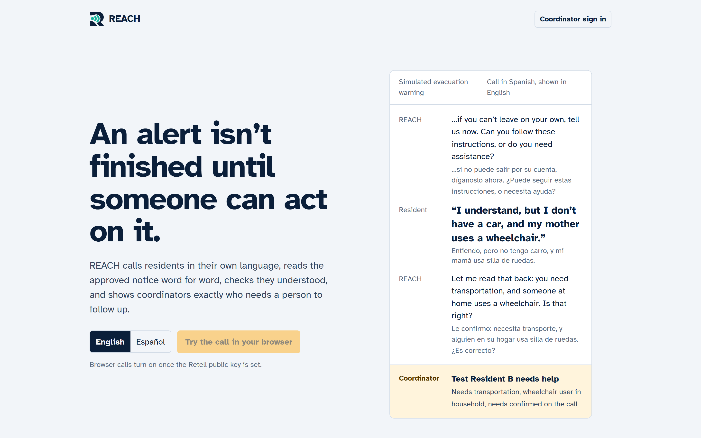
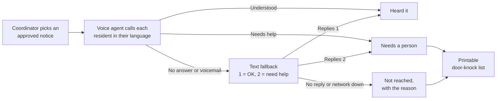
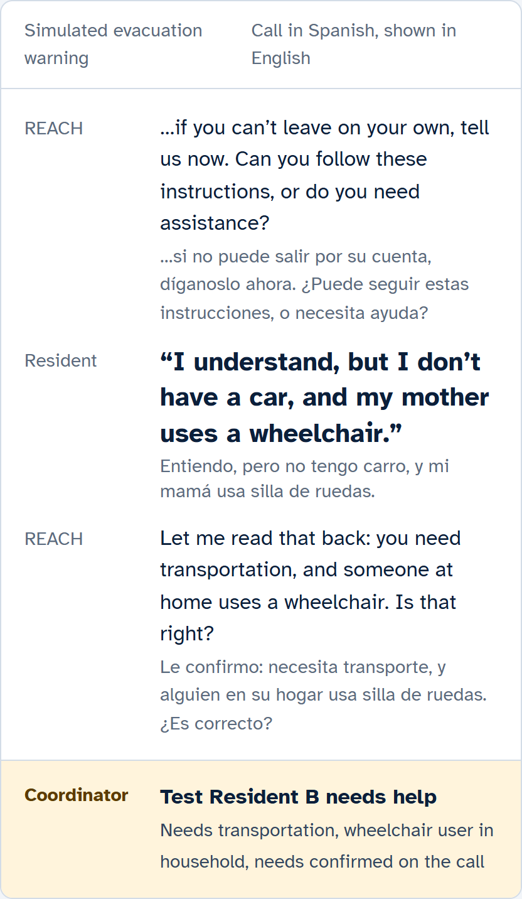
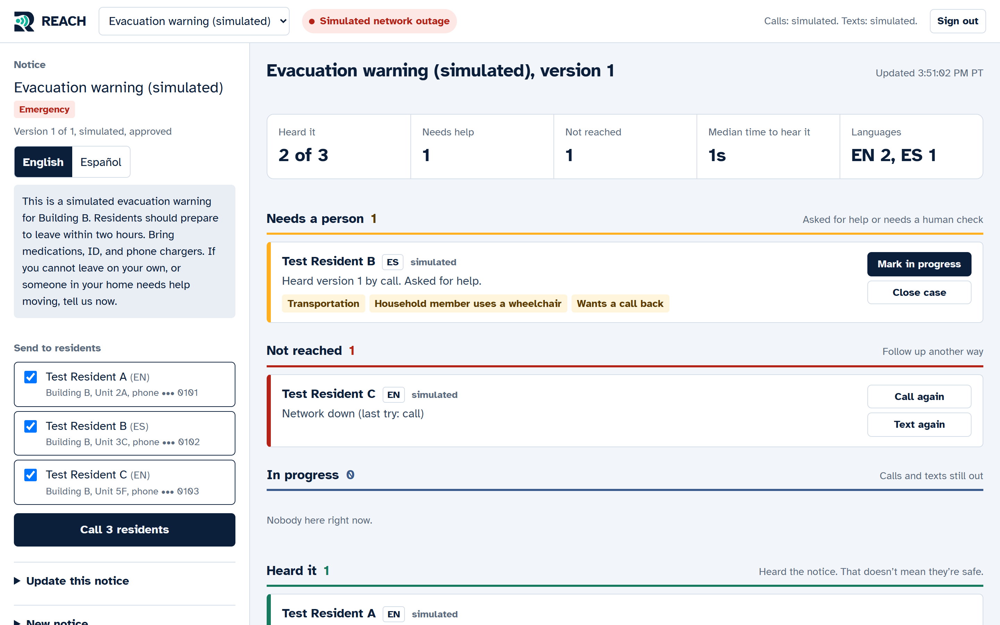
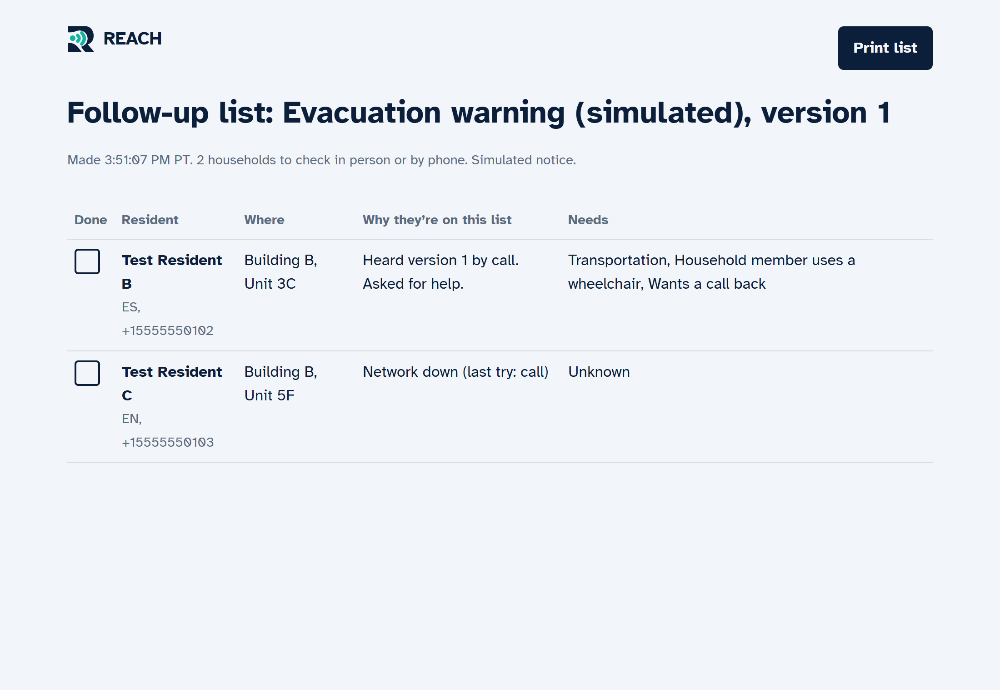
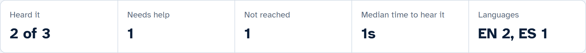

<p align="center">
  
</p>

<h1 align="center">REACH</h1>

<p align="center">
  <b>An alert isn't finished until someone can act on it.</b><br/>
  REACH calls residents in their own language, reads an approved notice word for word, checks they understood,<br/>
  and shows coordinators exactly who needs a person to follow up.
</p>

<p align="center">
  Built overnight at the <b>Dual-Use Hackathon</b> (USC Viterbi × InnovateLA), Resilience Comms lens (Retell AI),
  by Rafid, Enzo and Abdullah.
</p>



## Why

Emergency alerts are broadcasts. They assume a smartphone, a data connection and English, and they never find
out who actually heard them. The people most likely to miss an alert (older residents, people on basic phones,
people who don't speak English) are also the most likely to need help acting on it.

REACH closes that loop. On a normal day it sends building notices like elevator maintenance. In a crisis, the
same loop sends approved evacuation notices. That's what dual use means here.

## How it works



1. A coordinator picks an **approved** notice and the residents to reach.
2. A Retell voice agent calls each resident in their preferred language (English or Spanish in the MVP), reads
   the notice word for word, and asks: *"Can you follow these instructions, or do you need assistance?"*
3. If they need help, it asks about transportation, mobility needs and a call back, then reads the needs back to
   confirm. It never promises that help is coming.
4. If the call fails, REACH sends a text with numbered replies.
5. The dashboard sorts everyone into four lanes: **Needs a person**, **Not reached**, **In progress** and **Heard it**.

## Example: one call, start to finish

<table>
<tr>
<td width="45%"></td>
<td>

A resident gets the evacuation warning **in Spanish**. They say they understood, but they have no car and their
mother uses a wheelchair.

The agent reads the needs back to confirm them, and the call's post-call fields land on the coordinator's
dashboard as structured data:

- **Lane:** Needs a person
- **Needs:** Transportation, household member uses a wheelchair, wants a call back
- **Confirmed on the call:** yes

The coordinator never has to listen to the recording to know what to do next.

</td>
</tr>
</table>

## The coordinator dashboard



This is the 90-second demo in progress. Resident B asked for help in Spanish. Resident C didn't answer, and a
retry failed during a **simulated network outage**, so REACH keeps them on the board with the reason
("Network down") instead of hiding them. The strip at the top is the impact report: who heard it, who needs help,
who wasn't reached, the median time to acknowledge, and the languages served.

Everyone who needs a person, or couldn't be reached, prints as a door-knock list:

<p align="center">
  
</p>

> Every name and number here is a fake test resident (`+1 555` numbers). Hearing a notice doesn't mean
> someone is safe. The dashboard says so, and only a coordinator can close a case.

## Run it in 2 minutes (no keys needed)

```bash
npm install
cp .env.example .env.local      # DEMO_MODE=true is already set
npm run dev
```

Open http://localhost:3000 for the landing page and http://localhost:3000/dashboard for the dashboard (the password
is `DASHBOARD_PASSWORD` in `.env.local`). Without Retell keys, calls are simulated: each resident's card gets
buttons to play out the call. Simulated calls and texts go through **the exact same webhook handlers** as real
Retell and Twilio events, so the demo exercises the real logic.

### The 90-second demo

1. Dashboard → pick **Evacuation warning (simulated)** → **Call 3 residents**.
2. On the cards: A **Confirms**, B **Needs help** (Spanish, transport + wheelchair), C **No answer**, so C falls
   back to a text.
3. Click **Simulate a network outage**, then **Call again** on C. It fails with "Network down" and stays on the board.
4. **Open printable list** shows the door-knock list.
5. **Update this notice** → save as version 2 → send it. The version tabs show who heard v1 and who heard v2.
6. **Reset demo data** before you demo again.

### Checks

```bash
npm run test:logic   # 13 end-to-end logic checks, no network needed
npm run build
```

## Tech

| Part | What we used |
|---|---|
| App | Next.js 14 (App Router), TypeScript, plain CSS (no UI framework) |
| Voice | Retell AI agents in English (`en-US`) and Spanish (`es-419`), with post-call extraction, voicemail and do-not-call handling |
| Text fallback | Twilio (optional; simulated and labeled when not configured) |
| Storage | One JSON file locally, or Postgres via `DATABASE_URL` |
| Security | Webhook signature checks, only approved notices can be sent, a password-protected dashboard |

| Path | What lives there |
|---|---|
| `lib/outreach.ts` | All business logic: start, dial, webhooks, SMS fallback, replies, report, follow-up list |
| `lib/retell.ts`, `lib/sms.ts` | Retell calls and signature checks; SMS text, sending and reply parsing |
| `lib/regions.ts` | Per-region config: languages, timezone, alert authority, consent rules |
| `app/dashboard` | Coordinator UI |
| `docs/retell-prompt.md` | The voice agent's prompt; `npm run setup:retell` creates the agents from it |
| `docs/API.md`, `CLAUDE.md` | Every route, and the team's data contract |

## The hackathon

We built REACH in one weekend in October 2026, in the hackathon's Resilience Comms lens (Retell AI).

### Three twists, overnight

The organizers changed the scenario three times while we were building, starting just before midnight. We logged
each one and what it changed in the code in [`docs/TWIST_LOG.md`](docs/TWIST_LOG.md).

| When (PT) | Twist | What we shipped |
|---|---|---|
| Fri 11:31 PM | Name a federal funding pathway | NSF SBIR/STTR Phase I (as an STTR with Cal Poly Pomona), then city and county buyers using FEMA UASI funds. We built the **impact report** with the numbers both would ask for: reach rate, median time to acknowledge, assistance requests, languages and not-reached reasons. |
| Sat 4:30 AM | Make it global | Everything location-specific moved into `lib/regions.ts`. Our second region is **Odisha, India**, where cyclone warnings need to reach households on basic phones, using a Hindi agent. Storage was already global: UTC times, E.164 phone numbers, language codes. |
| Sat 7:00 AM | Make a poster | A poster for the Devpost submission, due at 10 PM. |

<p align="center">
  <br/>
  <sub>The impact report, built for the funding twist.</sub>
</p>

### Team

- **Rafid:** deployment, website, Devpost, deck, demo video, twist log
- **Enzo:** Retell voice agent, backend, SMS fallback
- **Abdullah:** coordinator dashboard

We wrote the data contract down first, in `CLAUDE.md`: string IDs, UTC times, E.164 phone numbers, and `null`
for "unknown" vs `false` for an explicit "no". That way the agent, the backend and the dashboard could be built
in parallel against the same shapes.

### What we learned

- **Telecom rules move slower than a hackathon.** Real US texting needs A2P 10DLC registration, which takes days,
  and Retell needs identity verification before it places outbound calls. So we built a simulator that runs
  through the real handlers and labels everything it fakes.
- **Pin your voice agent.** An edit in the Retell dashboard changes the agent's behavior instantly, so the demo
  pins `RETELL_AGENT_VERSION`.
- **Rate limits shape the product.** Retell starts one call per second by default, so outreach is paced to match.
- **"Global" is a language question first.** Retell doesn't support Bengali yet, so the Odisha example uses Hindi.
- **Show failure honestly.** No phone system works through a complete network outage. REACH can't fix that, but
  it can make sure nobody silently drops off the list.

## Responsible use

Someone could misuse a system like this to send fake alerts or impersonate officials. REACH limits that:

- Only notices marked approved can be sent.
- The agent says it's automated and never promises help is coming.
- Opt-outs are honored immediately.
- Webhook signatures are verified.
- Planned for a real deployment: delete call data after 7 days (not built yet).

## Going live

<details>
<summary><b>Connect Retell for real calls</b></summary>

1. Sign up at retellai.com, finish KYC (needed for outbound calls), add a payment method and buy a US number.
2. Deploy first (below) so you have a public https URL. For local dev, use `ngrok http 3000`.
3. Pick voices in the Retell dashboard, then run:
   `RETELL_API_KEY=key_xxx PUBLIC_BASE_URL=https://your-url npm run setup:retell`
   It creates the English and Spanish agents from `docs/retell-prompt.md`, with the post-call fields,
   do-not-call detection, voicemail handling and the webhook, and prints the agent IDs.
4. In Retell → Phone Numbers → your number, set the English agent as the **outbound** agent.
5. Set `RETELL_API_KEY`, `RETELL_FROM_NUMBER`, `RETELL_AGENT_ID_EN` and `RETELL_AGENT_ID_ES`, then redeploy.
   Leave `RETELL_AGENT_VERSION` empty while building, and set it to the published version before a demo.
6. Put your consented test numbers in `CONTACTS_JSON` (E.164), then **Reset demo data** so they load.

If every webhook returns 401, the signing key is wrong. Webhooks are checked against `RETELL_API_KEY`, or
`RETELL_WEBHOOK_KEY` if your webhook key is different.

**Browser call button:** create a Retell public key, allow your domain and `localhost`, and set the
`NEXT_PUBLIC_RETELL_*` variables. It uses the v3 browser SDK.

</details>

<details>
<summary><b>Deploy</b></summary>

**Render or Railway (tested):** create a Web Service from this repo with build command
`npm install && npm run build`, start command `npm start`, and the env vars from `.env.example`. File storage
works on a single server, but data resets when the server restarts.

**Vercel:** serverless has no persistent disk, so set `DATABASE_URL` (Supabase or Neon, pooled connection
string). The table is created automatically. This path hasn't been tested end to end yet.

</details>

## Known limits

- SMS is simulated unless you have a 10DLC-registered Twilio number. The dashboard labels simulated texts.
- Retell-managed numbers can only call US numbers.
- Bengali isn't supported by Retell yet; Hindi (`hi-IN`) and Urdu (`ur-IN`) are.
- Storage is one JSON document: fine for a demo, not for production.
- The Odisha region is an example config, not a deployment; local telecom rules still need checking.
